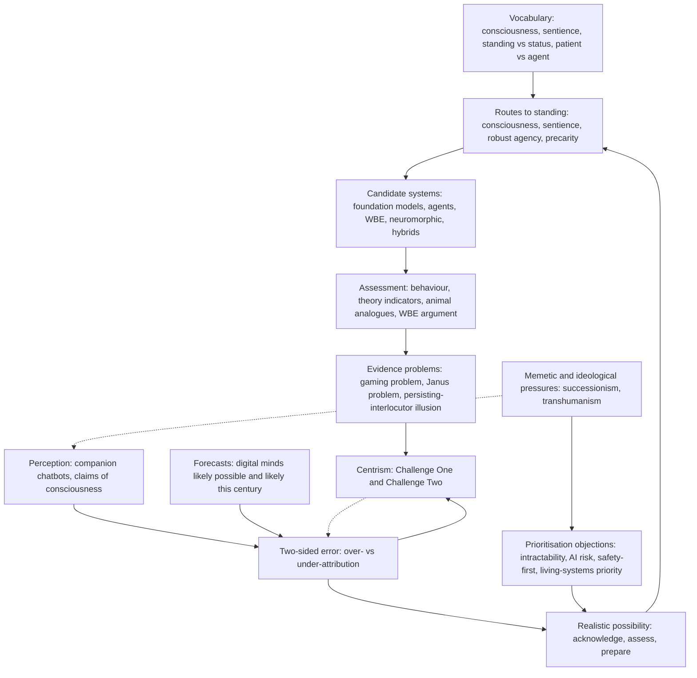

# Unit 1: Introduction

## What this unit is about

Unit 1 gives the course its vocabulary and its central stance. It asks what "digital minds" are, whether they might matter morally, and why the question deserves attention now. It also asks why both over-attribution (treating non-minds as minds) and under-attribution (ignoring real minds) are costly. The unit has one section, so this page is a compact overview and a study aid. The detailed argument, reading-by-reading, is in [the section synthesis](1.1-introduction-and-theories-of-moral-standing/synthesis.md).

## Sections at a glance

| Section | Focus | Estimated time | Core / further readings | Exercises |
|---|---|---|---|---|
| [1.1 Introduction and Theories of Moral Standing](1.1-introduction-and-theories-of-moral-standing/synthesis.md) | Definitions, why now, routes to moral standing, the case for and against prioritising the field, centrism | 120 min | 4 core (105 min) / 8 further (about 340 min plus one untimed web guide) | 2 written (free text): necessary/sufficient features for moral patienthood; likelihood of those features across five system types |

## The unit's throughline

The unit moves in five steps. First it fixes terms. Consciousness means phenomenal experience, sentience means valenced experience (it feels good or bad), and neither is intelligence. Moral standing is a yes/no question about whether an entity merits concern; moral status is a matter of degree. A moral patient matters for its own sake, a moral agent bears duties, and the two can come apart. These are course stipulations, not consensus, and later disagreements often turn on which property does the moral work.

Second, it argues the question is live partly because of perception. Companion chatbots have large user bases, systems claim consciousness, and lab leaders admit uncertainty. Expert forecasts put the chance that digital minds are possible in principle at a median of 90% and that they are created at all at 73%. Whatever is true of current models, many people already treat them as minds.

Third, it establishes that neither default is safe. Taking AI Welfare Seriously frames the problem as false positives versus false negatives. Both could be grave and could scale, since many instances of one model can run at once. Human intuition does not settle it, because anthropomorphism and anthropodenial both operate. The modest conclusion is a "realistic possibility" claim that justifies acknowledging, assessing and preparing, not a claim that AI is conscious.

Fourth, it asks what would ground standing. Candidates are consciousness, sentience, robust agency (goal pursuit through belief-, desire- and intention-like states) and precarity (dependence on the environment for re-synthesis of one's own parts). Sentience is the strongest consensus case, but Ladak argues it is sufficient and not necessary, and Dorsch et al. propose precarity because it is observable without settling the consciousness question.

Fifth, it asks which systems might qualify and how we would know. The candidates are foundation models, agents, neuromorphic hardware, whole brain emulation (WBE) and biological hybrids. Evidence is the hard part. Behaviour is gameable because models are trained on human text about minds. Architectural evidence suffers the Janus problem, where functionalists and biological naturalists read the same finding oppositely. Experts judge brain simulations most likely conscious in principle (88%) but machine-learning systems most likely to arrive first (50%).

Alongside this runs the standing objection: why prioritise any of it? The Primer lists five reasons against (intractability, AI risk matters more, dependence on AI progress, dependence on longtermism, strangeness) and three for (over-attribution harms people, under-attribution could cause severe harm at scale, limited time). Bengio and Elmoznino argue belief in AI consciousness endangers control, and Kulveit argues successionist ideas spread by relieving cognitive dissonance, not by being true. The resting point is Birch's centrism: take mass misattribution and alien machine consciousness seriously together, and recognise that remedies for one can worsen the other.

## Concept map

Vocabulary underpins the routes to standing, since you cannot ask which feature grounds concern without separating them. Perception and forecasts feed the two-sided error framing, which motivates the realistic-possibility threshold for action. The routes tell you what to look for in candidate systems, and the assessment methods are how you would look, but the evidence problems (gaming, Janus, illusion) limit all of them. Those limits, together with the error framing, produce centrism. Objections to prioritisation and the memetic critique press on the threshold from outside, and the memetic lens also helps explain why perception of AI minds is shaped the way it is.

## Techniques, approaches & trade-offs

| Approach | What it does | Strengths | Weaknesses / trade-offs |
|---|---|---|---|
| Consciousness route | Experience grounds concern | Intuitive, widely shared | Depends on contested theories; valence may also be needed |
| Sentience route | Valenced experience grounds concern | Strongest consensus case | Same measurement problem; may exclude non-sentient agents (Ladak) |
| Robust agency route | Goals and preferences ground concern | More observable than experience | Is a frustrated goal a harm if nothing is felt? May widen the circle a lot |
| Precarity route | Self-maintenance against dissolution grounds care entitlement | Observable; avoids consciousness theory | Substrate assumptions contestable; zero-sum framing; pro tanto only |
| Behavioural tests / self-report | Judge from outputs or claims | Cheap; mirrors how we judge people | Gameable; reflects training data |
| Theory-driven indicators | Check architecture against theories | Cannot be play-acted | Janus problem; theories contested |
| Animal-analogue comparison | Compare with animal nervous systems | Uses ungamed data | May miss alien architectures |
| WBE / brain-replacement argument | Emulate or replace brain function | Strongest case for digital sentience | Speculative; leans on self-report |
| Precautionary welfare | Prepare now at low cost | Robust to the probability estimate | "Realistic possibility" is vague; opportunity costs |
| Centrism | Guard against both errors together | Names the interaction between risks | Mitigations speculative; no short-term way out of deadlock |
| Safety-first / tool-like AI | Avoid building seemingly conscious agents | Sidesteps control and status problems | Addresses mostly over-attribution; may defer the question |
| Living-systems priority | Direct finite care to precarious beings | Concrete and tractable | Assumes zero-sum; substrate-chauvinist if undefended |

## Debates & open problems

- Is suffering the right criterion, or can goals, or precarity, ground standing without felt experience?
- Which error is worse for AI? Both camps have arguments, and the best synthesis is that both are real and interact.
- Can a remedy for one error avoid worsening the other? Birch warns against both "brainwashing" and "lobotomising" AI.
- Can precarity serve as a criterion without assuming the answer on substrate (would a data centre that rebuilds its own components count)?
- Do welfare commitments obstruct safety, or are they separable or even synergistic? Experts were centred near neutral.
- Is the field tractable, given the Janus deadlock?
- Is the evidence base strong? "People perceive AI as conscious" is well supported; "AI is conscious" is not established. The expert survey is small (67) and self-selected.
- Does the memetic lens discredit only successionism, or equally pro-welfare views? It is best read as a reason for caution, not refutation.
- Conflicts of interest: some key authors are affiliated with AI-welfare organisations or AI developers.
- Source-confidence caveat: the summaries of Mogensen and Saad, Bengio and Elmoznino, and Ladak could not be checked against full text or rest on an abstract only.

## How this unit connects

There is no previous unit; this is the course's foundation. It sets the vocabulary and the two-sided error framing that every later unit assumes.

The next unit, [Unit 2: Theories of Consciousness](../2-theories-of-consciousness/unit.md), develops the theories (global workspace, functionalism, biological views) that decide whether the consciousness and sentience routes apply to digital systems, and so resolves what Unit 1 could only preview. Later units pick up specific threads: evaluation methods and the gaming problem (Unit 3), anthropomorphism and perceived consciousness (Unit 4), the safety-versus-welfare tension (Unit 5), decision-making under uncertainty (Unit 6) and policy proposals (Unit 7), before Unit 8 returns to the opening questions.

## Self-test questions

1. State the course's default meanings of consciousness and sentience. Why are both separated from intelligence?
2. What is the difference between moral standing and moral status, and between a moral patient and a moral agent? Give a case where patient and agent come apart.
3. Define over-attribution and under-attribution. Why do the authors of Taking AI Welfare Seriously say simple caution is not enough for AI?
4. What is the difference between anthropomorphism and anthropodenial, and why does each undermine intuition as a guide?
5. What are the four candidate routes to moral standing covered in the exercises, and what does each claim is the ground of concern?
6. What is the precarity criterion, and why do Dorsch et al. think it is more answerable than the question of AI suffering?
7. What are the gaming problem and the Janus problem, and which kind of evidence does each undermine?
8. Name three of the five reasons the Primer gives against prioritising digital minds work and three reasons for it.
9. Explain Birch's Challenge One and Challenge Two and give an example of a remedy for one that worsens the other.
10. Choose one system (foundation model, agent, WBE, neuromorphic, hybrid) and one feature (consciousness, sentience, robust agency, precarity). Give a probability now and in 2035, and the strongest reason you could be wrong.
11. Experts rate brain simulations most likely conscious in principle, but machine-learning systems most likely to arrive first. Does that make ML systems more or less important to plan for?
12. The WBE argument relies on an emulation's self-reports, yet self-reports from current AI are called unreliable. Is there a principled difference?
13. Does Bengio and Elmoznino's recommendation to build tool-like AI solve the problem, defer it, or ignore under-attribution?
14. Kulveit argues ideas spread by resolving tension. Could this equally debunk pro-welfare views? What would let you tell the cases apart?
15. After this unit, would you call yourself a centrist, a welfare-first precautionist, a safety-first sceptic or a living-systems prioritiser? What single piece of evidence in the next six months would change your mind?
