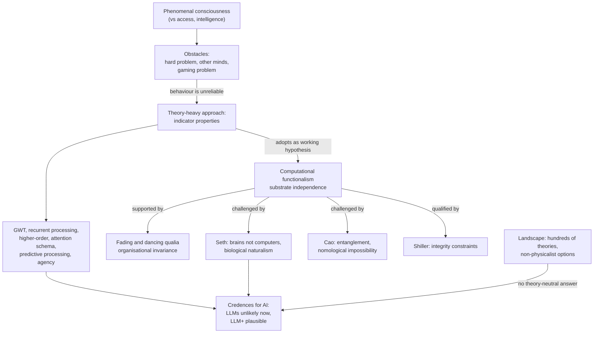

# Unit 2: Theories of Consciousness

## What this unit is about

Unit 1 asked what grounds moral standing. Unit 2 supplies the factual question many answers depend on: could a digital system have subjective experience? The unit has one section and it does three jobs. It fixes the vocabulary (phenomenal consciousness, access consciousness, qualia, functionalism). It names the obstacles to studying experience (the hard problem, the problem of other minds, the gaming problem). And it sets out the central dispute for AI: whether computation alone suffices for consciousness (computational functionalism, CF), which determines whether architecture-based assessment of AI is even coherent.

Note that four of the thirteen reading summaries rest on incomplete sources (Digital Minds I, the Schneider et al. primer, Seth and Bayne, Shiller); see the reliability note in the [synthesis](2.1-theories-of-consciousness/synthesis.md).

## Sections at a glance

| Section | Focus | Estimated time | Core / further readings | Exercises |
|---|---|---|---|---|
| [2.1 Theories of Consciousness](2.1-theories-of-consciousness/synthesis.md) | Problems in studying consciousness; theory-based indicators for AI; the case for and against computational functionalism | 122 min | 5 core (87 min, including the glossary) / 8 further, plus 2 reference notes | 2 (free text, core): pick one theory; weigh one argument for and one against CF on cf-debate.com |

## The unit's throughline

The argument runs in four moves, each forced by the one before. For the full version, see the [section synthesis](2.1-theories-of-consciousness/synthesis.md).

**1. Fix the target, then admit it resists study.** "Conscious" means phenomenal: there is something it is like to be the system. That is not intelligence and not access consciousness (information available for report and control). Because experience is private, we only infer it in others (other minds), and because explaining function does not obviously explain feeling, no theory has closed the hard problem. For AI there is a sharper third problem: a system trained on human text can produce the signs of consciousness without the thing (the gaming problem). Chalmers's example makes this concrete, since a one-word prompt change flipped what GPT-3 claimed about itself.

**2. Gaming pushes you from behaviour to architecture.** If outputs are unreliable evidence, look inside, which needs a theory linking processes to experience. Butlin et al. do this: they turn scientific theories (recurrent processing, global workspace, higher-order, attention schema, predictive processing, agency and embodiment) into 14 indicator properties and treat each one a system has as raising the probability of consciousness. Their verdict is that no current system is a strong candidate but nothing obvious blocks building one. Chalmers reaches a parallel verdict for LLMs (under about 10% now, 25% or more for extended "LLM+" systems within a decade), mostly because the gaps look like engineering problems.

**3. That method has a premise: CF.** Butlin et al. adopt CF as a working hypothesis for pragmatic reasons; if it is false, the checklists lose their grip. The main positive case is Chalmers's fading and dancing qualia arguments: replace neurons one by one with functionally identical chips, and experience must vanish abruptly, fade while the subject keeps insisting nothing changed, or stay the same. The last is the least absurd, hence organisational invariance.

**4. The premise is contested from several angles.** Seth argues that brains are not computers (no software-hardware split, continuous physical time, computation is one kind of dynamics) and that life itself may matter, a view called biological naturalism. Cao argues from neuroscience that brain functions are entangled with physiology so that faithful duplication is nomologically blocked, while noting this does not contradict Chalmers's principle. Shiller argues that even if function is what matters, a system must implement the organisation with integrity, which current networks arguably lack. Schneider et al. and the Landscape of Consciousness widen the frame: with hundreds of theories, including non-physicalist ones, "is this AI conscious?" has no theory-neutral answer.

The unit's lesson is therefore conditional. Any verdict on a digital mind inherits assumptions about theory and substrate, and the honest responses are explicit credences (Butlin, Chalmers) or caution about errors in both directions (Seth). Unit 3 turns this into methods for evaluating real systems.

## Concept map

The definition and the three obstacles motivate everything else. Gaming is what pushes assessment from behaviour to architecture, where the theories and their indicators live. Those indicators only transfer to AI if CF holds, so CF is the hinge: Chalmers's replacement arguments support it, while Seth, Cao and Shiller attack it from biology, neuroscience and implementation. Whatever the outcome, the landscape of rival theories means any final verdict is a credence, not a finding.

## Techniques, approaches & trade-offs

| Approach | How it works | Strength | Weakness | Trade-off / open problem |
|---|---|---|---|---|
| Behavioural / self-report tests | Judge by what the system says and does | Cheap, intuitive | Easy to game; humans over-attribute minds | Better, harder-to-game tests are an open challenge |
| Theory-heavy indicators (Butlin et al., Schiavo) | Convert theories into architectural checklists; set credence | Concrete, updatable, inspects the "engine" | Presupposes CF; indicators unweighted and ambiguous | No rule for combining indicators; mimicry of indicators possible |
| Replacement arguments (Chalmers 1995) | Reductio on absent and inverted qualia | Avoids intuition contests over odd systems | Rests on rational subjects noticing experience changes; silent on which organisation | Gives natural, not logical, necessity; feasibility left open |
| Biological naturalism (Seth) | Tie consciousness to life, metabolism, continuous dynamics | Matches the only known cases; links to predictive processing | No knock-down argument; unclear why metabolism matters | Rules out standard digital AI, not all artificial consciousness |
| Substrate entanglement (Cao) | Argue duplication is nomologically blocked | Empirically grounded; shifts burden to functionalists | Depends on grain; coarser functional levels not excluded | Weak against AI that does not copy neurons |
| Implementation constraints (Shiller) | Functionalism plus conditions on realisers | Handles the triviality worry; gives architecture-level verdicts | Constraints contested; may be engineered around | Neuromorphic hardware might satisfy them |
| Objection-and-credence analysis (Chalmers 2023) | List what LLMs lack and how fixable each gap is | Turns debate into a roadmap with probabilities | Credences loosely grounded | Roadmap doubles as a list of paths to avoid |
| Landscape surveys | Map hundreds of theories | Counters over-commitment | Not an evidence ranking | Breadth can dilute comparison |

## Debates & open problems

- **Is CF an assumption or a conclusion?** It is the only mainstream view on which architecture matters and AI consciousness is possible, yet Seth calls it unexamined and probably wrong. Whether the dispute shrinks once "computation" is defined broadly enough to include continuous dynamics is unsettled.
- **Do replacement and entanglement arguments really collide?** Cao says her view is compatible with invariance; the issue is whether a chip can instantiate the organisation, a question of principle for some and of resources for others.
- **What is the right grain of description?** Chalmers needs a grain that fixes behaviour, Cao doubts a tractable functional level exists, Shiller says implementation details matter.
- **Can architecture evidence be gamed too?** A system could be built to display a bottleneck or broadcast without the underlying function.
- **Which theory, and how to combine disagreeing ones?** No settled rule exists when two respected theories give opposite verdicts on one system.
- **Over- versus under-attribution.** Both errors are costly; Seth stresses conscious-seeming systems and warns that deliberately creating consciousness would be an ethical disaster.
- **Currency.** Several key sources (2022-2023) assess older systems; later units may update them.

## How this unit connects

**Previous: [Unit 1: Introduction](../1-introduction/unit.md).** Moral standing is often tied to phenomenal experience; this unit asks whether digital systems could have it.

**Next: [Unit 3: Evaluating mental states](../3-evaluating-mental-states/unit.md).** The gaming problem, indicators and the access versus phenomenal distinction become practical methods for evaluating real systems. Later units draw on the same material: Unit 4 on over-attribution and Seth's biological naturalism paper, Unit 5 on risks from attribution errors, Unit 6 on credence-based reasoning under theory uncertainty, and Unit 7 on what counts as a candidate digital mind for governance.

## Self-test questions

1. What does the course mean by "conscious", and how does it differ from intelligence and from access consciousness?
2. State the hard problem, the problem of other minds and the gaming problem. Which most undermines behavioural tests of AI consciousness?
3. What distinguishes functionalism, computational functionalism and substrate independence?
4. What is an indicator property in Butlin et al., and why does the method depend on CF being true or at least adopted?
5. Walk through the fading qualia argument. Which premise about rational subjects does it need?
6. List Seth's three lines of argument against treating brains as computers. Which is strongest, and why?
7. What is generative entrenchment, and how does Cao use it? Why does she regard her view as compatible with organisational invariance?
8. Why might Chalmers put under 10% on current LLMs but 25% or more on LLM+ systems within a decade? What does this imply about the nature of the gaps?
9. Choose one theory (for example global workspace). Which indicator would you check in a frontier system, and how could you distinguish real implementation from mimicry?
10. Seth concedes that broader forms of computation exist. Is the dispute with computational functionalists then largely verbal? Give the best case each way.
11. Evaluate Shiller's claim that function is not enough: does an integrity constraint rescue functionalism or quietly abandon it?
12. Two respected theories give opposite verdicts on the same AI system. What, if anything, should follow for how it is built, treated or deployed?
13. Which is the greater risk, over-attributing or under-attributing consciousness? What evidence would change your mind?
14. The Landscape lists hundreds of theories. Does that make the question intractable, or is the indicator approach a reasonable way to act anyway?
15. Take one argument for and one against CF from cf-debate.com. Does each fail on its logic or on an empirical premise, and does that distinction matter?
