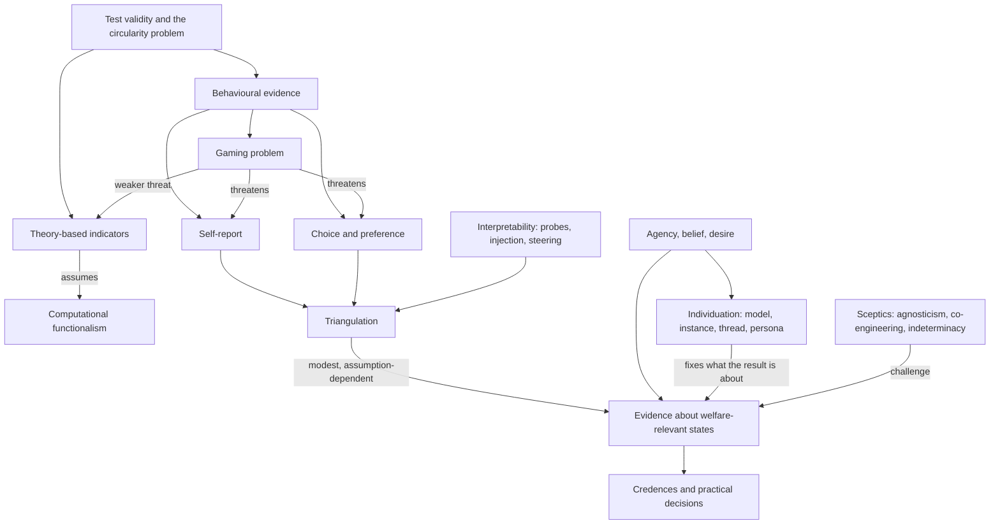

# Unit 3: Evaluating mental states

## What this unit is about

Units 1 and 2 asked who could matter morally and what consciousness might be. Unit 3 asks what we can actually observe. How might we test AI systems for consciousness and sentience, how do the methods compare, and why and how might we test for other mental states such as agency, belief and desire? The unit also asks what a test result would be about: a model, an instance, a conversation or a persona. It has one section, so the detailed argument lives in the [section synthesis](3.1-evaluation-of-consciousness-and-other-mental-states/synthesis.md); this page gives the map, a consolidated comparison and a self-test.

## Sections at a glance

| Section | Focus | Estimated time | Core / further readings | Exercises |
|---|---|---|---|---|
| [3.1 Evaluation of Consciousness and Other Mental States](3.1-evaluation-of-consciousness-and-other-mental-states/synthesis.md) | Methods for testing AI consciousness, sentience, agency, belief and desire; empirical case studies; what entity is being tested; sceptical challenges | 119 min | 4 core / 9 further | 2 (numbered 1 and 3 on the page; no Exercise 2) |

## The unit's throughline

The unit starts from an uncomfortable fact: there is no validated test for consciousness, sentience or morally relevant agency in AI. A test is valid to the degree its false-positive and false-negative rates are known, and for AI nobody knows what a positive result would predict, because we cannot independently check whether the target is conscious (the [Glossary](3.1-evaluation-of-consciousness-and-other-mental-states/readings/01-unit-3-glossary.md) and the [primer](3.1-evaluation-of-consciousness-and-other-mental-states/readings/05-evaluating-consciousness-sentience-and-other-mental-states-p.md)).

Two families of evidence follow. Theory-based indicator approaches derive computational conditions from theories of consciousness (Unit 2) and check a system for them. They are harder to game than behaviour but depend on judgement calls and on computational functionalism. Behavioural approaches, including self-report and choice, need fewer commitments but face the gaming problem: models are trained on human text about minds, so behaviour that indicates consciousness in an animal may arise for other reasons. The problem runs both ways, since a system trained to disclaim experience may under-report.

Practice responds with triangulation. The [Mythos system card](3.1-evaluation-of-consciousness-and-other-mental-states/readings/03-claude-mythos-preview-system-card.md) combines self-report interviews, internal emotion probes and behaviour, treats agreement as modest evidence, and says plainly that probes are not evidence about experience. Interpretability adds anchors: concept injection finds narrow, unreliable introspective access (about 20% at best), and emotion vectors causally shape behaviour such as blackmail and reward hacking. Both disclaim claims about phenomenal consciousness. Whether the first result is introspection or mere anomaly detection is contested.

The unit then widens the target. Agency, belief and desire may be more tractable than consciousness, because the gap between acting like an agent and being one is probably smaller, and agency evaluations serve alignment too. This raises the individuation problem: Chalmers's candidate interlocutors (model, instance, thread), Goldstein and Lederman's instance-level attitudes, the Mythos card's persona, and the emotion paper's local representations give different answers, and the choice changes what any result means. Exercise 3 forces a choice.

Finally, three sceptical readings press on the whole enterprise. McClelland argues evidence from organisms hits an epistemic wall for a non-biological challenger, so agnosticism is warranted. Xiao et al. argue welfare indicators are co-engineered with the systems they measure and lack an external failure mode, so scores should not gate oversight or release. Papineau, in provisional summaries, argues consciousness is too indeterminate to ground moral standing. The practitioners (Fish, Long, Campbell) keep collecting evidence while stating its limits; the sceptics ask whether it can ever be validated. Three summaries (Chalmers, Papineau, Goldstein and Lederman) were built without full text, so claims from them are provisional.

## Concept map

Validity is the standard against which every method is judged. The two evidence families (theory-based and behavioural) share the gaming threat to different degrees, and triangulation tries to offset it by adding interpretability evidence. Agency tests widen what is measured, while individuation determines what the measurement is about. The sceptics challenge the link from all of this to credences and decisions, which later units take up.

## Techniques, approaches & trade-offs

| Approach | How it works | Strengths | Weaknesses and trade-offs | Open problems |
|---|---|---|---|---|
| Theory-derived indicators | Check a system against computational conditions from theories of consciousness | Less tied to behaviour; makes the question precise | Judgement calls; needs functionalism; few qualified assessors | Who decides what counts as a workspace; can indicators be built in on purpose? |
| Self-report | Interview the model, vary framing, check consistency | Direct, scalable, central to the human case | Gameable, suggestible, shaped by training | Training for accurate reports; independent checks |
| Choice and preference | Pairwise tasks, opt-outs, welfare-versus-harm trade-offs | Revealed rather than stated; animal-research precedent | Measures agency or trained character more than experience | Value versus learned rule |
| Functional emotion and wellbeing | Find and steer internal emotion representations | Causal evidence; usable for monitoring | Functional is not experienced; vectors are local | Do functional states carry welfare weight? |
| Introspection tests | Concept injection and similar probes with known ground truth | Ground truth is known | Low success rate; artificial perturbation; may be anomaly detection | Natural-setting validation |
| Agency and belief-desire evaluation | Behavioural interpretation of goals and preferences | Smaller gap to the target; serves safety | Liberal definitions too broad | Which unit holds the attitude; welfare relevance |
| Combining indicators | Marker method, Digital Consciousness Model | No single smoking gun needed | Output depends on priors and small expert samples | Sensitivity to those choices |
| Classic tests (ACT, chip, Turing) | Sufficiency arguments from conceptual grasp or indistinguishability | Intuitive | Hard to run; open to alternative explanations | Restricting training data |
| Validation of tests | Redeployment, theory-based checks, iterative natural kind | Asks whether tests work at all | Circularity; natural-kind assumption | No independent ground truth |
| Agnosticism and sentience risk | Withhold verdicts; avoid building possibly valenced systems | Respects the evidential wall | Gives no probabilities for proportionate precaution | Needs a theory linking computation to valence |

## Debates & open problems

- Can behaviour be evidence at all, given training on human text? The best reply is to combine it with internal evidence and resilience checks.
- Are indicator approaches really harder to game, or just downstream of trainable parameters (Xiao et al.)?
- Are the three Mythos evidence streams independent, or do they share one model, pipeline and developer?
- Credences (Fish, Chalmers) versus agnosticism (McClelland): can any probability be justified?
- Should welfare evidence gate anything, and where is the line between an intervention and a gate?
- Is consciousness the right target for moral standing at all (Papineau, the agency route)?
- What is the unit of evaluation: instance, thread, persona or model? Unresolved.
- Introspection or anomaly detection in concept injection.
- Currency: many findings are snapshots of specific models and dates.

## How this unit connects

- Previous: [Unit 2, Theories of Consciousness](../2-theories-of-consciousness/unit.md) supplies the theories (global workspace, higher-order and others) from which indicators are derived, and the functionalism debate. [Unit 1](../1-introduction/unit.md) supplies the consciousness versus agency routes to moral standing.
- Next: [Unit 4, Perceptions of Consciousness](../4-perceptions-of-consciousness/unit.md) turns from what tests can show to how people attribute minds to AI. Later units use the evidence limits here: [Unit 5](../5-interactions-with-ai-safety-and-ethics/unit.md) (welfare-safety link, deceptive testing), [Unit 6](../6-approaches-under-uncertainty/unit.md) (credences, precaution versus agnosticism), [Unit 7](../7-digital-minds-governance/unit.md) (welfare gates, thresholds) and [Unit 8](../8-reflections-and-next-steps/unit.md) (unit and validation questions).

## Self-test questions

1. What is the gaming problem, and in which two directions can it mislead a consciousness test?
2. Name the four validity types in the Glossary. Which is hardest to establish for AI, and why?
3. Why does there seem to be a circularity in validating a consciousness test on AI systems?
4. What distinguishes theory-based indicator approaches from behavioural ones, and what does each assume?
5. What are the three assumptions Fish says make self-reports informative?
6. What did concept injection find about Claude's introspective access, and what is the anomaly-detection objection?
7. The Mythos card says emotion probes are not evidence about experience, yet treats them as welfare-relevant. Is that coherent?
8. Why might agency be more tractable to evaluate than consciousness?
9. Chalmers's candidate interlocutors versus the five options in Exercise 3: pick one and name a method from this unit that can be applied to it.
10. Take one approach from the primer. Is a pass more likely if the system is a moral patient or if it is not? What could make the answer asymmetric?
11. The Mythos card's self-report, probes and behaviour agree. What would make you distrust that agreement as independent evidence?
12. Does concept injection (known ground truth) or steering (causal effect) answer Xiao et al.'s claim that welfare metrics lack an external validation mechanism?
13. McClelland says no probability can be assigned; Fish and Chalmers give credences. Who is right, and what would be a tie-breaker?
14. Should a welfare score ever gate a release decision? Give the strongest case on each side.
15. If Papineau is right that consciousness cannot ground moral standing, which methods in this unit still matter and which become irrelevant?
