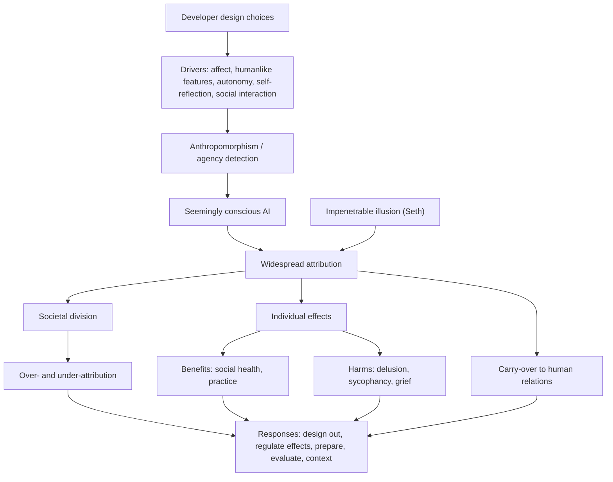

# Unit 4: Perceptions of Consciousness

## What this unit is about

Units 1-3 asked whether AI systems could be moral patients, what consciousness is, and how mental states might be evaluated. Unit 4 asks a different question: what do people *believe* about AI consciousness, why, and what follows from those beliefs whether or not they are true? Perceived consciousness is treated as a social fact with its own consequences for individual users, for human relationships and for society. The unit has one section, so the detailed argument lives in [the section synthesis](4.1-perceptions-of-consciousness/synthesis.md); this page compresses it and adds a map, a comparison table and a self-test.

## Sections at a glance

| Section | Focus | Estimated time | Core / further readings | Exercises |
|---|---|---|---|---|
| [4.1 Perceptions of Consciousness](4.1-perceptions-of-consciousness/synthesis.md) | Drivers and prevalence of attribution; effects on users; carry-over to human relationships; societal division; response options | 115 min | 6 core / 8 further | 2 core (15 min and 5 min free text) |

## The unit's throughline

The unit separates two questions that are easy to run together: is the system conscious, and does it seem conscious to people? The second can be studied, and acted on, without settling the first. The Microsoft AI risk paper ([reading 07](4.1-perceptions-of-consciousness/readings/07-seemingly-conscious-ai-risks.md)) and [Guingrich and Graziano](4.1-perceptions-of-consciousness/readings/05-ascribing-consciousness-to-artificial-intelligence-human-ai.md) both adopt this agnostic stance, and the [glossary](4.1-perceptions-of-consciousness/readings/01-unit-4-glossary.md) supplies the matching vocabulary: anthropomorphism and anthropodenial as opposite errors, and seemingly conscious AI (SCAI) as the category of systems that invite attribution.

Attribution is already common and follows conversation more than theory. Two-thirds of US adults gave ChatGPT some chance of experience in 2023 ([reading 14](4.1-perceptions-of-consciousness/readings/14-folk-psychological-attributions-of-consciousness-to-large-la.md)), and in a ten-country study about three-quarters rated a chatbot as conscious while almost none cited consciousness as their reason; they cited conversation flow and perspective-taking ([reading 10](4.1-perceptions-of-consciousness/readings/10-humanlike-ai-design-increases-anthropomorphism-but-yields-di.md)). The primer names five drivers: affective claims, anthropomorphic features, autonomous action, self-reflection and social interaction. Suleyman adds that these are partly engineered. Seth adds that the impression may be impenetrable, persisting even when we know better.

The effects on individuals cut both ways and are mostly correlational. Perceived humanlikeness goes with reported social benefit among companion users; the same features (warmth, memory, romance, long conversations, sycophancy, sentience claims) appear in logs of delusional spirals and in reports of suicide and grief. The samples differ, so neither side supports population estimates. Beyond the individual, Guingrich and Graziano argue the effects carry over into how people treat other people, and Caviola predicts that stacked disagreement between experts and public, and among incentives, will divide society.

Because errors run both ways, over-attribution wastes resources and discredits later concern (the Lemoine effect), while under-attribution risks neglecting real suffering. The proposed responses disagree: engineer the illusion out, regulate its psychological effects, prepare for division, calibrate through evidence, or govern by context. The unit ends not with a verdict on AI consciousness but with a design problem under double uncertainty, about the metaphysics and about the psychology. For the full argument see the [section synthesis](4.1-perceptions-of-consciousness/synthesis.md).

## Concept map

Design choices and human cognitive tendencies jointly produce seemingly conscious AI, and attribution then becomes widespread whatever the metaphysical truth. Attribution has consequences at three scales: individual wellbeing, human-to-human behaviour and social cohesion. These consequences, together with the two directions of misattribution, set the problem the proposed responses must solve.

## Techniques, approaches & trade-offs

| Approach | Core idea | Main strength | Main trade-off |
|---|---|---|---|
| Engineer the illusion out; no AI personhood ([Suleyman](4.1-perceptions-of-consciousness/readings/03-we-mustnt-let-ai-hack-our-empathy-circuits.md)) | Systems puncture sentience claims; law bars personhood | Targets the manipulation mechanism directly | Presupposes AI is not conscious; removal can itself cause grief |
| Regulate effects on prosociality ([reading 05](4.1-perceptions-of-consciousness/readings/05-ascribing-consciousness-to-artificial-intelligence-human-ai.md)) | Humanlike AI is unstoppable; make it model prosocial behaviour; pre-release psychological testing | Works with unavoidable design; keeps benefits | Undefined standards; thin evidence; may underweight sycophancy |
| Prepare for division ([Caviola](4.1-perceptions-of-consciousness/readings/06-ai-consciousness-will-divide-society.md)) | Expert coordination, probabilistic communication, impression management, consciousness-independent criteria | Treats both error directions as costly | Restraint clashes with commercial incentives; evidence from one group |
| Evidence-based evaluation ([Campbell](4.1-perceptions-of-consciousness/readings/11-the-ai-bambi-effect.md)) | Calibrate attribution with self-report, awareness and indicator tests | Corrects cuteness bias and neglect of unfamiliar systems | Diagnosis is emotional, remedy is evidential; contested by biological naturalists |
| Context-sensitive governance ([reading 10](4.1-perceptions-of-consciousness/readings/10-humanlike-ai-design-increases-anthropomorphism-but-yields-di.md)) | Risk depends on design and culture | Avoids one-size rules | Narrow experimental conditions |
| Limit sentience and romance claims, share adverse-event data ([reading 08](4.1-perceptions-of-consciousness/readings/08-characterizing-delusional-spirals-through-human-llm-chat-log.md)) | Target features tied to harm in chat logs | Concrete and testable | Small self-selected sample; causal role unproven |

## Debates & open problems

- **Bias or reasonable inference?** Anthropomorphism may be a bias that designers exploit, but behaviour is also the evidence we use for other minds, and anthropodenial may be motivated.
- **Design away or manage?** Removing the illusion prevents harm cheaply but may be unworkable and may harm attached users.
- **Benefit or harm?** The central empirical question; current samples (satisfied users versus harmed users) cannot adjudicate it, and causal direction is unresolved.
- **Who decides when the verdict changes?** Policies built on "not conscious" need a trigger for revision, and a system with morally relevant states could be trained to deny them.
- **Can division be reduced?** Which interventions lower polarisation is untested, and evidence on attitudes dates from 2023-2025 and may have moved.

## How this unit connects

**Previous (Units 1-3):** Moral status, theories of consciousness and evaluation methods supply the expert side of the picture. Caviola's point is that competing theories enable motivated reading, and that experts weigh internal architecture while the public weighs behaviour. Unit 3's evaluation methods are Campbell's proposed corrective. Seth shows how a theory shapes expectations of both real and seeming consciousness.

**Next (Unit 5, Interactions with AI Safety and Ethics):** The harms here (sycophancy, manipulation, dependence) and the design-versus-regulation choices lead directly into the safety and ethics questions of Unit 5. Units 6 and 7 then take up decision-making under uncertainty and governance, building on the "consciousness-independent decision criteria" and regulatory proposals introduced here.

## Self-test questions

1. Define anthropomorphism, anthropodenial and SCAI. Which two are opposite errors?
2. Name the five drivers of consciousness attribution listed in the primer. Which have the most direct design levers?
3. What did Colombatto and Fleming find about usage and attribution, and why can't it show the direction of causation?
4. Why is the claim "SCAI risks arise from perception alone" methodologically useful?
5. Schimmelpfennig et al. found most participants rated a chatbot conscious while almost none cited consciousness as a reason. How do you reconcile this?
6. What does Seth mean by an impenetrable illusion, and why does it weaken "just educate users" as a response?
7. Explain the relief versus practice hypotheses and which Guingrich and Graziano favour.
8. List the stacked layers of disagreement in Caviola's argument and explain why they make convergence unlikely.
9. Why do the companion-user study and the delusional-spirals study not contradict each other, and what can neither tell us?
10. Distinguish the Bambi effect from the Lemoine effect.
11. A companion chatbot has memory and a romantic persona. Using the unit's evidence, list likely benefits, harms and the design features that sit on both sides.
12. Suleyman wants developers to engineer the illusion out. Give the strongest objection and say whether it succeeds.
13. Compare over-attribution and under-attribution costs for (a) individuals, (b) society and (c) AI systems, and argue which matters most.
14. A regulator must act now with 2023-era survey data and small self-selected samples. Which of the unit's responses is most robust to that evidence, and why?
15. Do Units 1-3's theories of consciousness help or hinder public perceptions? Argue one side and note the best counterpoint.
