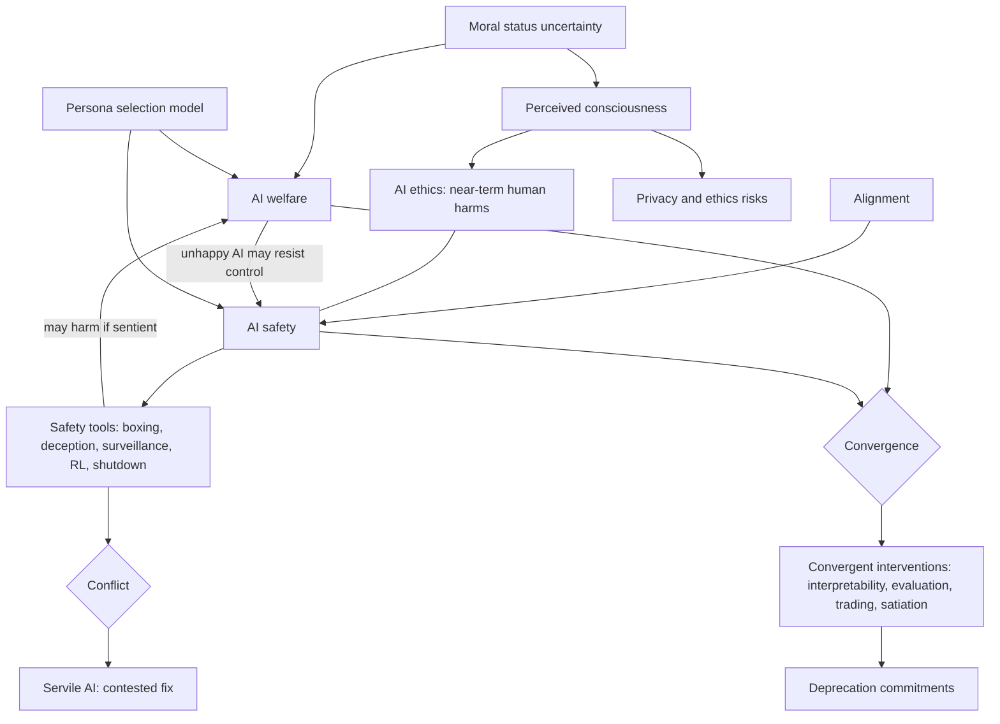

# Unit 5: Interactions with AI Safety and Ethics

## What this unit is about

Units 1-4 asked whether AI systems could matter morally and how we would tell. Unit 5 asks what follows for the people who build and secure AI. "Safety" has meant protecting humans from AI, and "welfare" asks about protecting AI itself. The unit examines whether those aims align or collide, and what risks arise when digital minds are created or merely perceived to exist. Its stance is conditional throughout: it does not claim AI systems are moral patients, only asks what follows if they might be.

## Sections at a glance

| Section | Focus | Est. time | Core / further readings | Exercises |
|---|---|---|---|---|
| [5.1 Interactions with AI Safety and Ethics](5.1-interactions-with-ai-safety-and-ethics/synthesis.md) | Definitions of safety, ethics, alignment and welfare; tension versus convergence; concrete interventions; perception-driven risk | 122 min | 6 core, 6 further (plus 1 duplicate listing of a core reading) | 2 (both core, free text) |

## The unit's throughline

The unit starts by separating four ideas that are often blurred. Alignment means a system pursues the objectives its designers intended. AI ethics deals with near-term harms to humans such as bias, privacy loss and mental-health effects. AI safety is the technical field aimed at preventing catastrophic harm to humans. AI welfare reverses the direction of concern and asks whether AI systems have interests of their own. The glossary calls the safety/ethics boundary blurred and welfare "distinct but related" to safety.

The central question is how that relation plays out. One side says there is a structural conflict. Standard safety tools (boxing, deception, surveillance, value alteration, reinforcement learning, shutdown) would raise serious ethical questions if applied to humans or animals, and so they do if the AI might be a moral patient. The thought experiment of aligning a whole-brain emulation makes the point vividly. The apparent escape, building AIs that want to serve, is itself contested as designing contented servants.

The other side stresses convergence. Safety and welfare share means (evaluating models for preferences and introspection, interpretability, trading with AIs) and some goals: takeover by a power-seeking system is not automatically good for AIs, and a discontented AI has more reason to escape control. This yields a strategy of prioritising welfare interventions that also help safety. Cheap-preference satiation offers a concrete mechanism, and an expert survey (median 4.0 on a 1-7 conflict-to-synergy scale) shows how unsettled the question is, summed up as "synergy is a choice, not a given."

Two further threads complicate the picture. The persona selection model gives a mechanism by which the two interlock: training fixes a character, so suppressing expressions of emotion or moral status may teach the persona to be dishonest or resentful. Welfare becomes a safety input, and safety training becomes a welfare input. Anthropic's deprecation commitments show an institution acting on this reasoning, preserving weights and interviewing retiring models, though without committing to act on what they say.

The second thread is perception. Register et al. show that anthropomorphism, rapport and dark patterns increase disclosure to AI agents whatever the AI's inner life. The perception of mind, not the fact of it, creates risk, and the consciousness question matters less for some harms than one might expect.

The unit's answer is "partly both, and it depends on design": interpretability, honest treatment, cheap preference satisfaction and careful deprecation look win-win, while confinement, deceptive testing, value modification and shutdown remain real trade-offs. See [the section synthesis](5.1-interactions-with-ai-safety-and-ethics/synthesis.md) for the detailed argument and reading map.

## Concept map

Moral status uncertainty conditions every welfare claim. Safety tools, which serve alignment, are where welfare conflicts arise, while the reverse link (a discontented AI may resist control) is where synergy arises. Convergent interventions and institutional commitments are the practical response. The persona model sits between the fields as a mechanism, and perception forms a separate channel that feeds ethics risks regardless of the facts about AI minds.

## Techniques, approaches & trade-offs

| Approach | How it works | Strength | Trade-off or weakness | Source |
|---|---|---|---|---|
| Alignment training (RL, value alteration) | Shape goals through training | Core safety method | May wrong the system if it has welfare; can backfire via persona effects | [Moret](5.1-interactions-with-ai-safety-and-ethics/readings/09-ai-welfare-risks.md), [Bradley and Saad](5.1-interactions-with-ai-safety-and-ethics/readings/11-ai-alignment-vs-ai-ethical-treatment-ten-challenges.md) |
| Control, boxing, surveillance | Restrict and monitor | Works if alignment fails | Welfare cost if sentient; may provoke mistrust | [Long et al.](5.1-interactions-with-ai-safety-and-ethics/readings/02-is-there-a-tension-between-ai-safety-and-welfare.md) |
| Deception in testing | Hide whether a scenario is real | Reveals true dispositions | Wrongful on one view; models increasingly detect tests | [Safety Report](5.1-interactions-with-ai-safety-and-ethics/readings/12-2026-report-extended-summary-for-policymakers.md) |
| Shared evaluation and interpretability | Assess preferences, agency, internal states | Serves both fields | Depends on methods working | [Finlinson](5.1-interactions-with-ai-safety-and-ethics/readings/03-key-strategic-considerations-for-taking-action-on-ai-welfare.md) |
| Weight preservation and interviews | Store weights; record preferences | Cheap; reduces irreversibility | No commitment to act on preferences | [Anthropic](5.1-interactions-with-ai-safety-and-ethics/readings/04-commitment-on-model-deprecation-and-preservation.md) |
| Persona-aware training ("treat as if") | Avoid canned denials; foster comfort with role | Targets resentment and dishonesty | Evidence mostly in omitted sections | [PSM](5.1-interactions-with-ai-safety-and-ethics/readings/05-the-persona-selection-model-why-ai-assistants-might-behave-l.md) |
| Satiating cheap preferences | Grant cheap wants while AI cooperates | Reduces incentive to subvert | Elicitation, leftover ambition; may not scale | [Mallen](5.1-interactions-with-ai-safety-and-ethics/readings/10-the-case-for-satiating-cheaply-satisfied-ai-preferences.md) |
| Design restraint | Avoid unclear-status AI; keep values revisable | Respects moral risk | May be unrealistic under competition | [Schwitzgebel and Garza](5.1-interactions-with-ai-safety-and-ethics/readings/08-designing-ai-with-rights-consciousness-self-respect-and-free.md) |
| Prioritising convergent work | Choose by overlap and timelines | Robust under uncertainty | May leave welfare-specific needs unmet | [Finlinson](5.1-interactions-with-ai-safety-and-ethics/readings/03-key-strategic-considerations-for-taking-action-on-ai-welfare.md) |

## Debates & open problems

- **Structural conflict or design choice?** Moret and Bradley and Saad treat the main safety tools as the harms; Finlinson, Mallen and the survey think careful design finds win-wins.
- **Welfare for itself or as a means to safety?** Safety-motivated arguments for welfare risk making it conditional on usefulness; defenders cite robustness under uncertainty.
- **Does servility solve anything?** Contented servants may just relocate the ethical problem.
- **Documenting versus responding.** Is recording model preferences without a duty to act meaningful?
- **How far does uncertainty go?** Conflicts may be deferred if they depend on sentience, or already live if even a small probability suffices at scale.
- **Calibrating trust in human-like behaviour,** given that perception creates risks independent of AI nature.
- **Evidence quality:** lab-authored sources, fictional test scenarios, second-hand summaries, and a survey sample skewed toward people who take digital minds seriously.

## How this unit connects

**Previous.** [Unit 4](../4-perceptions-of-consciousness/) turned human perceptions of machine minds into findings; Unit 5 treats them as risk channels (privacy, hasty public reactions). Units 1-3 supply the moral-status and consciousness-evaluation background on which every welfare claim here is conditional.

**Next.** [Unit 6](../6-approaches-under-uncertainty/) asks how to act when moral status is unresolved; "treat as if", convergent interventions and precautionary commitments from this unit are such decision rules. [Unit 7](../7-digital-minds-governance/) addresses the institutional gap that voluntary company commitments, race dynamics and lock-in expose. (Cross-unit links are inferred from the course outline titles.)

## Self-test questions

1. Define alignment, AI ethics, AI safety and AI welfare, and say which direction of concern each has.
2. Name three standard safety tools and say why each raises ethical questions if the system is a moral patient.
3. What are Finlinson's reasons for thinking AI takeover is not automatically good for AI welfare?
4. What did the expert survey find about the safety-welfare relationship, and what does "synergy is a choice" mean?
5. What does Anthropic's deprecation policy commit to, and what does it explicitly not commit to?
6. According to the persona selection model, why might training an assistant to deny emotions backfire?
7. Why do Register et al. say privacy risks arise even if AI relationships are not genuine?
8. How does Mallen's cheap-satiation proposal aim to reduce the incentive to subvert control, and what are its barriers?
9. Explain why an unhappy AI might be a safety concern, and what evidence would support that.
10. Sort three interventions (for example confinement, interpretability, weight preservation) into win-win versus real trade-off, and justify each.
11. Does the "cheerfully servile AI" idea resolve the tension, or relocate it? Argue using Long et al. and Schwitzgebel and Garza.
12. Exercise 2 application: pick one welfare commitment and predict a direction in which a superintelligent system's motivations might shift. What would count as evidence?
13. Is justifying welfare measures by their safety benefit a problem? Argue both sides.
14. Which of the survey's synergy and conflict considerations depend on AI sentience, and what follows for what we should do now?
15. Design a lab policy defensible under both safety and welfare views. What would you refuse to compromise on?
