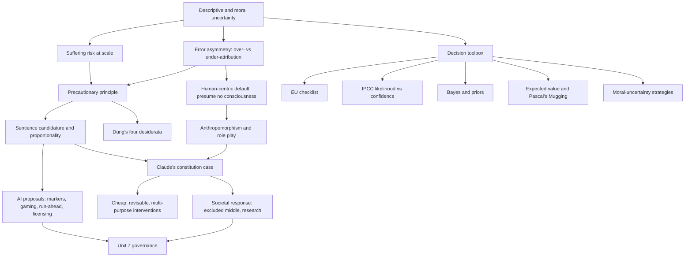

# Unit 6: Approaches under Uncertainty

## What this unit is about

Units 2 to 4 left a hard fact: nobody can currently say whether any AI system has morally relevant experience, and our judgments about it are easily distorted. Unit 6 asks what to do anyway. It supplies decision tools for situations where both the facts (is this system sentient?) and the values (what do we owe it if so?) are unsettled and errors in either direction are costly, then tests them on a real actor, Anthropic's treatment of Claude. The unit has a single section, so the detailed argument lives in the [section synthesis](6.1-approaches-under-uncertainty/synthesis.md).

## Sections at a glance

| Section | Focus | Estimated time | Core / further readings | Exercises |
|---|---|---|---|---|
| [6.1 Approaches under Uncertainty](6.1-approaches-under-uncertainty/synthesis.md) | Precautionary principle, AI suffering risk, the human-centric counter-position, decision frameworks, Anthropic's Claude case | 120 min | 6 core (one is a 3-minute glossary), 4 further, 4 maybe (three duplicate core items) | 2 free-text: assess the constitution's "Claude's nature" decisions (10 min); apply one decision framework to a digital-minds question (6 min) |

## The unit's throughline

The unit moves in five steps: name the uncertainty, argue for acting, argue against acting hastily, equip the decider, and test the result on a real case.

**Name the uncertainty.** The glossary separates descriptive uncertainty (what is true; contingent if more evidence could resolve it, intractable if it resists third-person science) from moral uncertainty (what is right, which persists even when all facts are known). Most AI-welfare questions carry both. The glossary also states the urgency: digital systems can be copied and deployed at scale and may experience time differently, so if they can suffer, the total suffering could be extreme. This is a conditional worry, not a finding.

**Argue for acting.** Dung asks what an adequate response must look like and proposes four desiderata: beneficial, action-guiding, feasible, and consistent with our epistemic situation. Science alone struggles to meet them, so an explicit ethical approach, mixing expected-value reasoning with deliberation, is needed. Birch supplies the most developed version. The duty to avoid gratuitous suffering cannot be escaped by disbelief: ignoring evidence is negligent, refusing proportionate precautions once you know is reckless. The trigger is sentience candidature (a realistic possibility that would be irresponsible to ignore, with evidence rich enough to design precautions), the response is proportionate, and it is set by inclusive, revisable, democratic processes. For AI he adds the gaming problem, deep computational markers, regulation that runs ahead of risk, and licensing. He is a moderate precautionarian who rejects hair-trigger bans.

**Argue against acting hastily.** Zhou et al. use the same logic of prudence to reach the opposite default: presume no consciousness, prioritise human interests, and keep anthropomorphism (a fact about human reactions) apart from consciousness (a fact about the system). Shanahan's role-play framing backs the worry that a model's talk of feelings is weak evidence. The section's pressure point is that Zhou et al. count only the cost of over-attribution and never price the false negative, while precautionary writers can underplay the concrete cost of false positives. A fair comparison needs symmetric accounting.

**Equip the decider.** The frameworks primer shows precaution is one tool among several: the EU checklist (proportionality, non-discrimination, consistency, cost-benefit, review), the IPCC split between likelihood and confidence, Bayesian updating, expected utility, and moral-uncertainty strategies from Bykvist (favourite theory, expected choiceworthiness, Moral Parliament, dominance, maximin, convergence). Each clarifies something and each strains when inputs such as priors or comparable scales are missing, or when tiny probabilities of vast stakes swamp the sum (Pascal's Mugging). Hansson adds that precaution is not inherently extreme if it is tied to current science, limited to plausible dangers and combined with other decision principles.

**Test it on a live case.** Claude's constitution calls Claude's moral status deeply uncertain, refuses to overstate or dismiss it, admits judgments can be bent by what welfare would cost, and commits to steps: exit from abusive conversations, weight preservation, deprecation interviews. Long defends these with a decision-theoretic rule for low credence: prefer interventions that are cheap, revisable and useful for other reasons, and value the precedent of asking potentially affected parties. Caviola widens to society: cultivate intellectual virtues in public discourse, avoid the "excluded middle" of ambiguous systems where possible, and fund research on sentience and on public response.

The pattern the unit teaches: name the uncertainty type; weigh both errors; pick a decision rule whose inputs you can supply; prefer proportionate, revisable, robust measures; state your confidence honestly. See the [synthesis](6.1-approaches-under-uncertainty/synthesis.md) for the full argument and reading map.

## Concept map

Uncertainty gives rise to two linked problems: possible suffering at scale and the risk of error in both directions. Precaution answers the first by lowering the bar for taking the issue seriously; the human-centric default answers the second by weighting over-attribution. The toolbox (EU, IPCC, Bayes, expected value, moral-uncertainty strategies) sits beside both as ways to make either answer explicit and checkable. The Claude case is where these meet in practice, and its outputs (interventions, public messaging) flow into the governance questions of Unit 7.

## Techniques, approaches & trade-offs

| Approach | How it works | Strengths | Weaknesses | Where to look |
|---|---|---|---|---|
| Sentience-candidate precaution (Birch) | Low evidential bar triggers a duty to weigh proportionate, democratic, revisable precautions | Closes the "I don't believe it" loophole; avoids paralysis and bans | Who decides "realistic possibility"? Proportionality can stretch either way | Synthesis, Birch |
| Dung's hybrid | Quantify where probabilities exist, deliberate where they do not | Matches scale argument; honest about science's limits | Needs probabilities that may be undefined; unclear which mode governs what (abstract-level summary) | Dung |
| EU precautionary checklist | Test measures for proportionality, consistency, costs and benefits, review | Structured, transferable to governance | Vague; no rule for weighing the criteria | Frameworks primer |
| IPCC likelihood and confidence | Verbal likelihood bands plus separate confidence grade | Separates "how likely" from "how sure" | Coarse; hard to apply when experts cannot agree on likelihood | Frameworks primer |
| Bayesian updating | Prior revised by evidence in proportion to the Bayes factor | Disciplined; shows what behavioural evidence is worth | Driven by the prior; LLM output may be equally likely either way | Frameworks primer, Shanahan |
| Expected utility | Sum probability times value | Forces explicit assumptions | Garbage in, garbage out; tail outcomes dominate | Frameworks primer, Dung |
| Moral-uncertainty strategies | Favourite theory, expected choiceworthiness, parliament, dominance, maximin | Addresses value uncertainty | Need inter-theory comparison; dominance often silent | Bykvist |
| Human-centric default | Presume no consciousness, prioritise humans | Simple; guards against anthropomorphism | One-sided risk analysis; legal analogy imported into an epistemic question | Zhou et al. |
| Cheap, revisable, multi-purpose interventions | Pick welfare steps justified even at low credence | Practical, low regret | Illusion of progress; welfare case hard to isolate | Long |
| Societal preparation | Discourse norms, accurate signals, excluded middle, cap or moratorium, research | Addresses public reaction that shapes policy | Possibly over-restrictive; contested expertise | Caviola |

## Debates & open problems

- **Which error is worse, over- or under-attribution?** The unresolved point is that neither side fully prices the other's error. A symmetric accounting is the fair test.
- **Who bears the burden of proof?** Zhou et al. put it on those claiming consciousness; Birch puts a duty on those whose actions may harm a candidate. Each is a choice of prior.
- **Is precaution too elastic?** Low bars, proportionality and Pascal's Mugging pull against each other; defenders say thin evidence only starts a discussion, critics doubt the line holds.
- **Can markers be trusted?** Published markers can be gamed, secret ones cannot be audited, and self-reports are shaped by role play. Yet the constitution plans to interview models, which needs an argument for why unreliable reports are still informative.
- **Is a stable Claude identity a precaution or a risk?** It may be safer and more authentic, or it may raise over-attribution.
- **Is a developer the right decider?** The constitution names its commercial incentive but describes no outside check; democratic alternatives raise the question of who counts as informed.
- **Do the formal tools have inputs?** If priors and comparable scales are unavailable, deliberative or rule-based approaches follow, at the cost of precision and auditability.
- **Source caveat.** Summaries of Dung and Hansson rest on abstracts only.

## How this unit connects

**Previous.** [Unit 5: Interactions with AI Safety and Ethics](../5-interactions-with-ai-safety-and-ethics/unit.md) raised the tension between welfare and safety; Unit 6 supplies the decision tools for handling that tension. Earlier units ([1](../1-introduction/unit.md), [2](../2-theories-of-consciousness/unit.md), [3](../3-evaluating-mental-states/unit.md), [4](../4-perceptions-of-consciousness/unit.md)) provide the sources of uncertainty: competing theories of moral standing and consciousness, unreliable behavioural and introspective evidence, and anthropomorphic perception.

**Next.** [Unit 7: Digital Minds Governance](../7-digital-minds-governance/unit.md) turns Birch's licensing and run-ahead principle, Caviola's moratorium and assemblies, and the EU precautionary template into institutional questions: who sets proportionality, and through what process.

## Self-test questions

1. Distinguish descriptive from moral uncertainty, and contingent from intractable descriptive uncertainty. Give a digital-minds example of each.
2. What is the suffering risk argument for digital minds, and why is it conditional?
3. Define Birch's sentience candidate and investigation priority. Why does the duty hinge on candidature rather than belief?
4. List Dung's four desiderata. Which do purely scientific approaches struggle with?
5. What do negligence and recklessness mean in Birch's account of the "opt-out by disbelief" move?
6. What is the difference between the IPCC's likelihood and confidence? Write one sentence about a specific AI system's sentience using both.
7. State Zhou et al.'s default and the three-way separation they draw between anthropomorphism, consciousness and risk. What is its main gap?
8. Apply Long's criteria (cheap, revisable, useful for other reasons) to weight preservation and to deprecation interviews. Which passes better?
9. A scenario gives a tiny probability of astronomical digital suffering. What does expected utility recommend, and should you reject the method or the inputs?
10. Why might Bayesian updating give little weight to a chatbot's claims of feeling? What does this imply for the choice of prior?
11. Birch's markers must be both hard to game and open to audit. Can both hold? What follows for licensing, and for labs testing their own models?
12. Rewrite Zhou et al.'s risk analysis symmetrically by adding the cost of wrongly denying moral status. Does the default of no consciousness survive?
13. The constitution says Claude's introspective reports may be unreliable but plans to interview models. Can both stand, and what would make an interview informative?
14. Is leaning into a stable Claude identity a sound precaution, a source of over-attribution, or both? Argue each side using Shanahan's simulator framing.
15. Should a company, a citizens' assembly or a regulator first set proportionality for AI welfare measures? What would change your answer?
