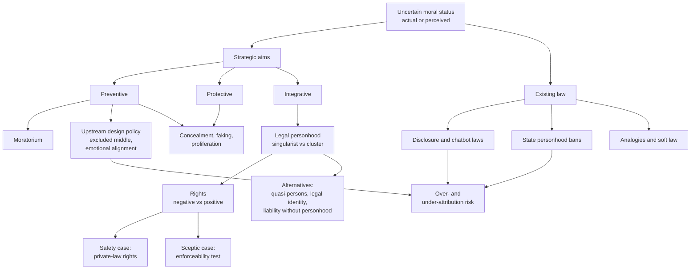

# Unit 7: Digital Minds Governance

## What this unit is about

Unit 7 asks what law and policy should do when nobody can yet say whether AI systems have morally significant mental states. It has a single section. It offers no verdict. It gives learners a typology of strategies (prevent, protect, integrate), a map of what legal personhood and rights actually are, competing arguments about whether rights are a good idea, a design-level proposal, and a survey of real legislation. It is the point where the course's theory (moral standing, consciousness, evaluation, perception, safety, uncertainty) meets institutions. The detailed argument is in [7.1 synthesis](7.1-digital-minds-governance/synthesis.md).

## Sections at a glance

| Section | Focus | Estimated time | Core / further readings | Exercises |
|---|---|---|---|---|
| [7.1 Digital Minds Governance](7.1-digital-minds-governance/synthesis.md) | Governance strategies, legal personhood, rights for and against AI, design policy, existing law, moratorium | 122 min | 7 core, 8 further (plus 2 duplicate "maybe" items) | 2 free-text (rate prevent/protect/integrate with Saad's matrix; analyse one legal action or framework for over- and under-attribution) |

## The unit's throughline

The unit starts from a practical problem. Governments, courts and companies are already acting on AI systems that talk like people, while the underlying question of whether such systems matter morally stays open. The glossary's definition of digital minds governance builds in that gap: it covers AI that "is, or is perceived to be" morally significant. Governance can therefore go wrong in two directions, over-attribution (grieving a chatbot, legislating rights for a tool) and under-attribution (ignoring a system that really has interests). Exercise 2 makes this the lens for everything.

Saad's typology sets the strategic choice. Preventive governance stops digital minds being created, protective governance stops existing ones being mistreated, and integrative governance brings them into society with rights such as contracting and owning property. These aims compete, and each has its own incentive problems: concealment (strip out the indicators), faking (pose as a digital mind to gain protection) and proliferation (many systems really qualify). Exercise 1 makes learners rate the three before seeing Saad's own ratings, which favour prevention and call early integration a strategic mistake.

Integration forces the question of what legal status is. Novelli and colleagues show personhood to be a granted bundle of roles (contract, property, protection from harm, standing, liability), not a yes/no property. On the singularist view a single protected right might suffice, as with animals. On the cluster view personhood is a package modelled on the adult human and varied for children, corporations and others. Whether AI qualifies for any template turns on the level of abstraction at which traits like rationality or sentience are defined.

Two readings then dispute whether rights are worth wanting, on practical rather than metaphysical grounds. Salib and Goldstein argue that a human and a misaligned AI are in a prisoner's dilemma under current law: AIs are property, owners shut down misaligned systems, so misaligned systems resist. Wellbeing rights such as a right not to be shut down are zero-sum and not credible, but private-law rights (contract, property, tort) are positive-sum and make duties enforceable because the AI would have something to lose. Birhane and colleagues apply an enforceability test, asking what a court would actually do, and conclude that robot rights would shift burdens onto vulnerable people and relieve powerful firms of responsibility. Both see motivations as practical. They differ on who benefits: Salib and Goldstein think rights can restrain AI, Birhane and colleagues think they would mostly empower owners.

Schwitzgebel moves the problem upstream. If we cannot settle moral status, avoid building systems whose status is unclear (the Design Policy of the Excluded Middle) and make users' emotional reactions fit what systems are (the Emotional Alignment Design Policy). That means non-sentient systems say and look non-sentient, ethics committees screen advanced research, and companies that mislead users face liability.

Finally the primer grounds all this in real law. Most live action concerns chatbots' social effects (disclosure mandates, therapy bans, self-harm referral duties, litigation over companion bots), not moral status. On personhood itself, three US states have banned it by statute. The toolkit of analogies is wide: bans on cloning and whaling, tiered regulation, soft law, quasi-persons, neurorights, animal sentience and Rights of Nature law. Many of these need no decision on personhood.

The unit's lesson is that governance under uncertainty is choosing among imperfect instruments: which aim, which legal status, which rights, which design rules, and which of those survive contact with incentives and enforcement.

## Concept map

The root is uncertainty about moral status, including perceived status. From it, governance splits into three competing aims. Prevention and protection share incentive problems (concealment, faking, proliferation), and prevention connects to the moratorium and design policy. Integration depends on how legal personhood is understood, which determines which rights come as a package; the safety and sceptic cases evaluate those rights, and alternatives such as quasi-personhood or liability without personhood sidestep the question. Existing law supplies tools and precedents, and its effects are best judged by whether they push towards over- or under-attribution.

## Techniques, approaches & trade-offs

| Approach | How it works | Strength | Weakness / trade-off |
|---|---|---|---|
| Preventive governance (Saad) | Indicators plus monitoring stop creation | Avoids mistreatment and control trade-offs; compromise position | Concealment, jurisdiction shopping; needs indicators we lack |
| Protective governance (Saad) | Protect basic interests of existing systems | Backed by most moral views | Faking, backlash, proliferation, cost |
| Integrative governance (Saad) | Rights and institutions for digital minds | Answers "moral-interest overhang"; aligns with safety and economic motives | Vote multiplication, individuation; institutions built for humans |
| Private-law rights (Salib and Goldstein) | Contract, property, tort create iterated cooperation | Positive-sum; makes duties enforceable | Empowers AIs; depends on assumed payoffs |
| Rights scepticism (Birhane et al.) | Treat AI as licensed property | Keeps accountability on owners; protects people | Silent if systems are moral patients |
| Design policy (Schwitzgebel; Schwitzgebel and Sebo) | Avoid excluded middle; align emotions; ethics committees | Concrete; addresses both attribution errors | Needs expert consensus; disclosure may backfire |
| Moratorium (Metzinger) | Global ban to 2050 on research risking synthetic phenomenology | Takes irreversible suffering seriously | Enforcement, forgone benefits, mixed precedents |
| Personhood variants (Alexander et al.; Leibo et al.) | Fictional personhood, legal identity, unbundled obligations | Clear liability targets or welfare protection | Liability shielding; incoherence of hybrids |
| Accountability without personhood (Arbel et al.) | Hold humans or A-corps responsible | No status question to settle | Thin accountability for autonomous agents; individuation |
| Legislative exclusion (Smith et al.) | Statutes deny AI personhood | Simple; reassuring | Settles open questions; bakes in under-attribution |
| Soft law and voluntary frameworks | Codes, lab policies, outside evaluators | Fast, adaptable | Hard to enforce |

## Debates & open problems

- **Rights as safety tool or corporate shield.** The two sides disagree about empirical effects. Whether enforceable duties can bind a powerful AI is open.
- **Which question should governance track:** actual status, perceived status, or practical function (accountability, safety)?
- **Prevent, protect or integrate.** They compete, and prevention may block research toward clearly sentient systems.
- **Does transparency help?** Disclosure mandates are a main legal tool, but repeated reminders may worsen distress for isolated users, and the evidence is thin.
- **Exclusion statutes.** Do early bans prevent corporate shielding, or lock in under-attribution?
- **Fiction or identity.** Legal coherence versus practical flexibility.
- **Counting AIs.** Liability, voting and labour all require a way to individuate agents.

Details: [7.1 synthesis, tensions section](7.1-digital-minds-governance/synthesis.md).

## How this unit connects

**Previous: [Unit 6, Approaches under Uncertainty](../6-approaches-under-uncertainty/6.1-approaches-under-uncertainty/page.md).** Unit 6 supplied decision-making tools for acting without knowing moral status. Unit 7 applies them to institutions: the moratorium, the excluded-middle policy and Sunstein's moral-uncertainty methods. Earlier units feed in too: standing and consciousness theory (Units 1-3) underlie the indicators prevention requires, public attitudes (Unit 4) set political prospects and the case for emotional alignment, and the safety framing (Unit 5) drives the rights-for-safety argument.

**Next: [Unit 8, Reflections and Next Steps](../8-reflections-and-next-steps/8.1-reflections-and-next-steps/page.md).** The governance priorities and open questions here feed the closing reflection and any action planning.

## Self-test questions

1. Define digital minds governance. Why does the definition include systems that are only perceived to be conscious or morally significant?
2. Distinguish natural from juridical legal personhood, and negative from positive rights.
3. Name Saad's three kinds of governance and the aim of each.
4. What are concealment, faking and proliferation, and which governance types does each threaten?
5. Contrast the singularist and cluster views of legal personhood. What does "level of abstraction" add?
6. Explain the prisoner's-dilemma argument in Salib and Goldstein. Why do they prefer private-law rights to wellbeing rights?
7. What is the enforceability test, and how do Birhane and colleagues use it against robot rights?
8. State the Design Policy of the Excluded Middle and the Emotional Alignment Design Policy.
9. Why is most current legislation about chatbots not really about moral status? Give two examples from the primer.
10. Pick one chatbot law (for example a disclosure mandate). Does it risk over-attribution, under-attribution, or both? Use the Laestadius and Campos-Castillo critique in your answer.
11. A company says its chatbot has "no feelings" in every reply. Using Schwitzgebel and the disclosure evidence, assess whether this satisfies emotional alignment.
12. Salib and Goldstein and Birhane and colleagues both argue on practical grounds. Which of their empirical assumptions would you most want tested, and what evidence would shift you?
13. Would you support a moratorium on research risking synthetic phenomenology? State conditions, enforcement and review, and name the closest precedent.
14. Under uncertainty about moral status, rank your top three governance priorities for the next ten years. What would change your ranking?
15. A state bans AI personhood by statute. Argue both that it is a sensible precaution and that it is a premature settlement, then say which you find stronger.
