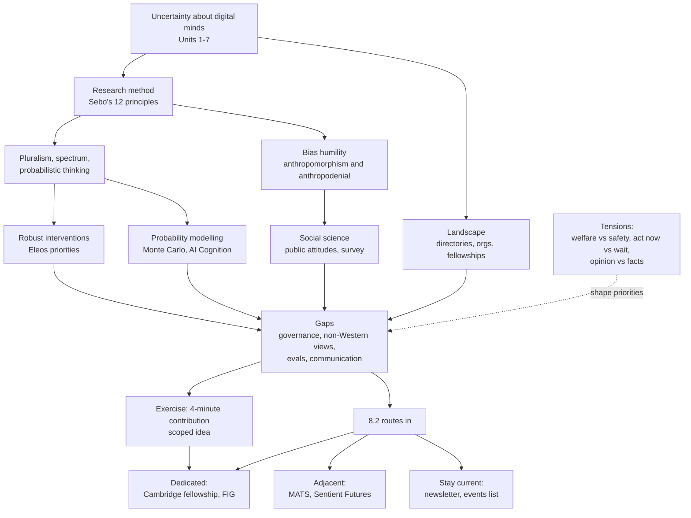

# Unit 8: Reflections and Next Steps

## What this unit is about

Unit 8 is the capstone. It introduces no new theory. Its question is: given how much the earlier units showed to be uncertain, what should a thoughtful person do next, and on what principles? It has two parts. [8.1](8.1-reflections-and-next-steps/synthesis.md) maps the field (organisations, research principles, competing agendas), asks you to consolidate what you learned, and ends in a brainstorming document and a 4-minute presentation for your group. [8.2](8.2-next-steps/synthesis.md) is a short signposting page listing six ways to keep learning or start contributing. The detailed argument lives in the section syntheses; this page gives the overview, the concept map, a consolidated comparison and a self-test.

## Sections at a glance

| Section | Focus | Estimated time | Core / further readings | Exercises |
|---|---|---|---|---|
| [8.1 Reflections and Next Steps](8.1-reflections-and-next-steps/synthesis.md) | Field directories, research principles, agendas and gaps; reflection and a 4-minute contribution | 120 min | 2 core / 7 further / 1 maybe (a duplicate of a core reading) | 1 (brainstorming doc and presentation) |
| [8.2 Next steps](8.2-next-steps/synthesis.md) | Six routes: newsletter, Cambridge fellowship, events list, Future Impact Group, MATS, Sentient Futures | Not stated (short closing list) | 0 / 0 (six linked resources, none assigned) | None |

## The unit's throughline

The unit moves from learning to contributing, and its argument has four steps: the field exists, it has a method, it has gaps, and there are routes in.

**The field exists, but it is small and self-described.** The core directory ([Otherminds.ai resources](8.1-reflections-and-next-steps/readings/01-otherminds-ai-resources-page.md)) lists about ten organisations, five fellowships and a handful of grants and events. The second map ([Mapping the Field of Artificial Consciousness](8.1-reflections-and-next-steps/readings/09-mapping-the-field-of-artificial-consciousness.md)) lists 47 organisations. Both are curated by people with an interest in growing the field, give no inclusion criteria and no deadlines, so they orient rather than rank. The governance scoping study ([reading 6](8.1-reflections-and-next-steps/readings/06-digital-minds-governance-early-scoping-from-expert-interview.md)) confirms the picture from inside: governance barely exists, there is no talent pipeline, and a motivated newcomer can reach the frontier within months.

**The field has a method, and it is the course's uncertainty toolkit compressed.** Sebo's [twelve principles](8.1-reflections-and-next-steps/readings/02-principles-for-ai-welfare-research.md) swap binary, certainty-seeking questions ("is AI conscious?") for graded, particular and probabilistic ones ("what capacities does this kind of system have, and with what confidence?"). They add pluralism, multidisciplinarity and a frank admission that our own correctives for bias (including "reject anthropomorphism") are unreliable. This is Unit 6 turned into a researcher's checklist, and it supplies a test for everything else in the unit: does a given programme or agenda actually behave pluralistically and probabilistically?

**The agendas are competing answers to "what first?"** The Further readings are best read as a menu of gaps. Eleos ranks work by robustness, tractability and overlap with safety, and favours interventions that are justified even if current systems turn out not to be welfare subjects. Rethink Priorities proposes a Monte Carlo model of the probability of AI consciousness plus studies of introspection and preferences. Caviola's agenda argues that public and decision-maker beliefs will shape outcomes, so how people attribute sentience is itself a research object, and the first survey data (582 researchers, 838 US adults) show similar timelines but different views on "never" and on regulating now. The governance interviews show most of 29 experts opposed binding legislation as premature but wanted quiet institution-building and welfare-safety coordination. The EA Forum debate week reminds us that "should this be a priority at all?" is a separate question from "how do we research it?"

**Contribution is the exercise.** The brainstorming document walks you through remember, analyse, evaluate and create prompts, then asks you to choose a contribution type (an open question, an argument, a critique, an explainer, a framework, a policy proposal, a project idea or a career reflection) and shape one idea into four minutes. The skills being tested are the unit's lessons: be specific about which source you rely on, how old it is, and whether it reports findings, plans or self-description.

**The routes in are mostly adjacent and mostly closed.** [8.2](8.2-next-steps/synthesis.md) is candid that digital minds is nascent: career paths are unclear, positions are scarce, and the hard skill is project scoping. Only the Cambridge Digital Minds Fellowship (a seven-day residential programme that expects the online course as a prerequisite) and Future Impact Group's AI Sentience stream are dedicated. MATS is an AI safety fellowship where digital-minds mentors sometimes appear; Sentient Futures is a broader moral-circle incubator. In the captured snapshot nearly every cohort had closed, so the practical action is to subscribe to the newsletter and events list and prepare a scoped project. The FIG project list doubles as an open-problems map that reconnects to Units 2 to 7.

**Three cautions run through the unit.** Dates matter: several sources are two or more years old in a fast-moving field. Many sources are institutional self-descriptions. And many readings propose what to study rather than reporting results. A good final contribution says which of these it relies on.

## Concept map

Uncertainty from Units 1 to 7 forces two responses: a method for working under it, and a map of who is doing what. The method generates research approaches (robust interventions, probability models, social science), each of which exposes gaps. Gaps are what you pick for your 4-minute contribution and what the 8.2 programmes help you scope. The dotted tensions (welfare vs safety, acting now vs waiting, public opinion vs facts about the entity) are not resolved by the unit but determine how agendas are prioritised.

## Techniques, approaches & trade-offs

| Approach or route | How it works | Strengths | Weaknesses | Trade-off |
|---|---|---|---|---|
| Principles-based method (8.1, Sebo) | Apply twelve cross-cutting principles from animal welfare research | Humble, pluralistic, flexible | Says what to be mindful of, not what to run; bias correctives unreliable | Precaution vs expected value unresolved; animal analogy may fail for trained systems |
| Intervention prioritisation (8.1, Eleos) | Score interventions on evidence, impact, convergence, risk, tractability, neglectedness | Practical; robust to uncertainty about welfare | Checklist, not numbers; monitoring distress could teach concealment | Sidesteps whether welfare exists; self-reports are shaped by training |
| Welfare evals and benchmarks (8.1) | Preference and introspection tests; composite benchmark from existing evals | Standardised; builds on safety evals | Best assessment methods are laborious; proxy relevance uncertain | Depends on which consciousness theory the eval assumes |
| Probability modelling (8.1, AI Cognition) | Monte Carlo model over theories and indicators | Makes uncertainty explicit and updateable | Weights unspecified; false precision risk | Validation across architectures |
| Social science (8.1, readings 3 and 5) | Surveys, experiments, forecasting, citizens' assemblies | Measures what shapes outcomes | Stated attitudes unstable; low response rates; sample bias | Public opinion vs moral truth |
| Expert interviews (8.1, reading 6) | Semi-structured interviews with 29 experts | Fast scoping of a new field | Informal; US/UK AI-safety skew | Signals, not estimates |
| Community debate (8.1, reading 8) | Time-boxed forum event | Surfaces cruxes cheaply | Invited-author bias; bundled question | Priority framing vs empirical questions |
| Cambridge Digital Minds Fellowship (8.2) | 7-day residential programme, mentor pairing, 15 fellows | Direct continuation; network; project scoping; funded | Very selective; 2026 round closed | Highest density, lowest availability |
| Future Impact Group (8.2) | Part-time (8+ hrs/week) mentored projects | Concrete questions; well-known leads | Wants specific skills; cohort-based | Output depends on your autonomy |
| MATS (8.2) | 12-week funded full-time fellowship | Strongest established pipeline | Not about digital minds; competitive | Credibility first, then steer to welfare |
| Sentient Futures Incubator (8.2) | 10-week remote, 5+ hrs/week, 80+ mentors | Accessible; own-project option | Broader than digital minds | Breadth helps moral-circle thinking but dilutes focus |
| Newsletter and events list (8.2) | Quarterly digest; curated events and jobs | Zero commitment; tells you when programmes open | Passive; time-sensitive; listing is not vetting | Low cost, low leverage alone |

## Debates & open problems

- **Public opinion vs facts about the entity.** Studying beliefs about AI sentience shapes policy-relevant knowledge, but treating opinion as a proxy for moral status risks letting popular error decide. Over- and under-attribution are both live risks.
- **Act now vs wait.** Precautionary research and robust interventions now, versus delaying binding law because of lock-in and credibility ("crying wolf") risk. These are compatible only if "now" means research and soft institutions. Path dependence can cut both ways if harm is already occurring.
- **Welfare vs safety.** Control-based safety may conflict with welfare; cooperation mechanisms may serve both. Experts call the relationship a central open strategic question.
- **Quiet vs loud.** Quality and caution versus credible public communication, with little evidence on what persuasion works.
- **Priority vs pluralism.** Whether AI welfare merits a fixed share of resources, or whether that bundles empirical questions with a premise sceptics reject.
- **Measurement reliability.** Framing-dependent survey answers, self-reports shaped by training, and unspecified weights in probability models.
- **Representation.** Self-curated, Anglophone directories; gaps in non-Western, religious and non-functionalist perspectives.
- **Dedicated vs adjacent routes, technical vs philosophical skills, and absorptive capacity.** Credibility and jobs sit in AI safety, yet adjacent programmes may leave digital minds a side project; the field needs both skill sets; and encouraging entry to a field with few positions risks oversupply.

## How this unit connects

**Previous (Unit 7, [Digital Minds Governance](../7-digital-minds-governance/7.1-digital-minds-governance/synthesis.md)).** The governance scoping study here is the closest follow-up to Unit 7, and the "act now vs wait" debate restates its legislation-versus-institution-building questions. The Code of Practice and research-ethics projects in 8.2 continue that work.

**Earlier units.** Unit 8 revisits each one as a source of gaps: moral standing ([Unit 1](../1-introduction/1.1-introduction-and-theories-of-moral-standing/synthesis.md)), theory disagreement ([Unit 2](../2-theories-of-consciousness/2.1-theories-of-consciousness/synthesis.md)), welfare evals ([Unit 3](../3-evaluating-mental-states/3.1-evaluation-of-consciousness-and-other-mental-states/synthesis.md)), public attribution ([Unit 4](../4-perceptions-of-consciousness/4.1-perceptions-of-consciousness/synthesis.md)), safety tensions ([Unit 5](../5-interactions-with-ai-safety-and-ethics/5.1-interactions-with-ai-safety-and-ethics/synthesis.md)) and decisions under uncertainty ([Unit 6](../6-approaches-under-uncertainty/6.1-approaches-under-uncertainty/synthesis.md)).

**Next.** This is the final unit. The continuation is outside the course: the newsletter, the Cambridge fellowship and the mentored programmes in [8.2](8.2-next-steps/synthesis.md).

## Self-test questions

1. (Recall) Name four kinds of opportunity listed in the Otherminds.ai directory, and two limitations of it as a planning tool.
2. (Recall) Group Sebo's twelve principles into epistemic stance, question framing and context, and give one example in each.
3. (Recall) What did the 2024 survey find about timelines, and where did researchers and the public differ most?
4. (Recall) Which of the six 8.2 routes are dedicated to digital minds, and which are adjacent?
5. (Understanding) Why does Sebo treat "reject anthropomorphism" as an unreliable corrective, and what does he recommend instead?
6. (Understanding) What does "robustly justifiable intervention" mean in the Eleos agenda, and why does it matter under uncertainty about welfare?
7. (Understanding) Why does the Cambridge fellowship make project scoping a central skill?
8. (Application) Choose one Eleos priority and apply its checklist. What would you rank it, and what evidence would change your mind?
9. (Application) Take one FIG project and trace it back to the unit where its underlying problem first appeared.
10. (Analysis) Most governance experts opposed legislation yet agreed current systems should not have rights. How are these reconciled, and where does the path-dependence argument cut the other way?
11. (Analysis) How might funding and affiliation (company team, university, nonprofit, safety fellowship) shape what each calls "welfare"?
12. (Evaluation) Is it legitimate to prioritise studying public attitudes toward AI sentience, or does it let opinion substitute for facts? Use readings 2, 3 and 5.
13. (Evaluation) Make the best case for entering digital minds through MATS rather than a dedicated programme, then the best case against.
14. (Judgment) Most listed cohorts were closed when the pages were captured. Draft a 12-month plan with one learning habit, one programme and one small project, and say what you would drop if you had only five hours a week.
15. (Judgment) Draft the headline sentence of your 4-minute presentation. Which source would you cite, and what caveat about its date or type would you attach?
